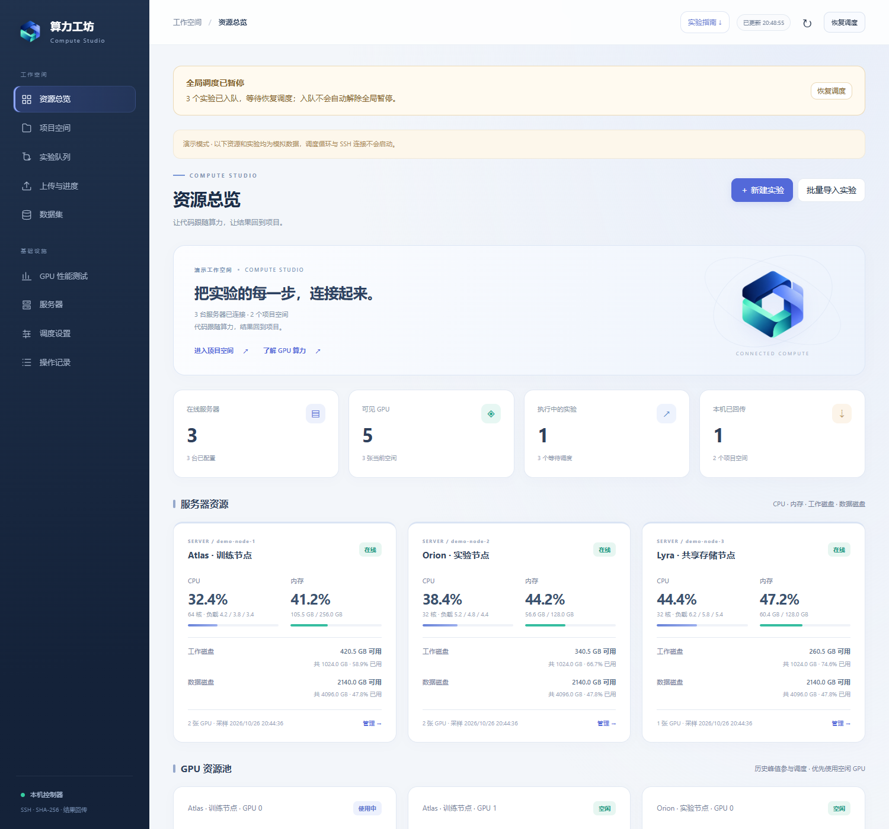
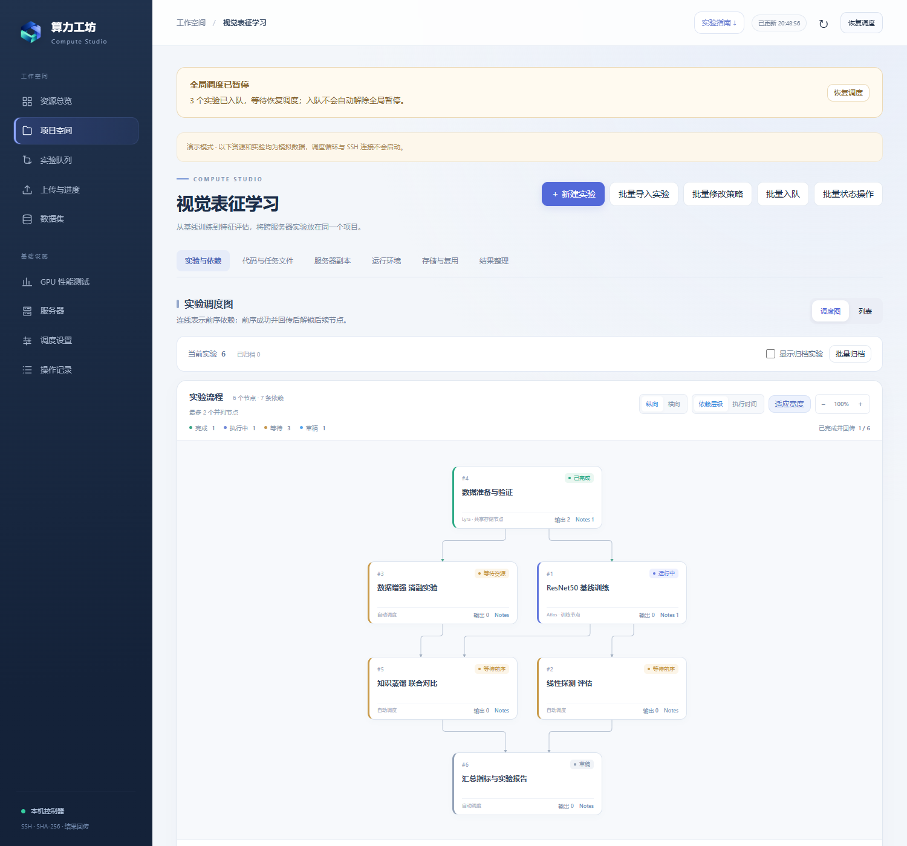
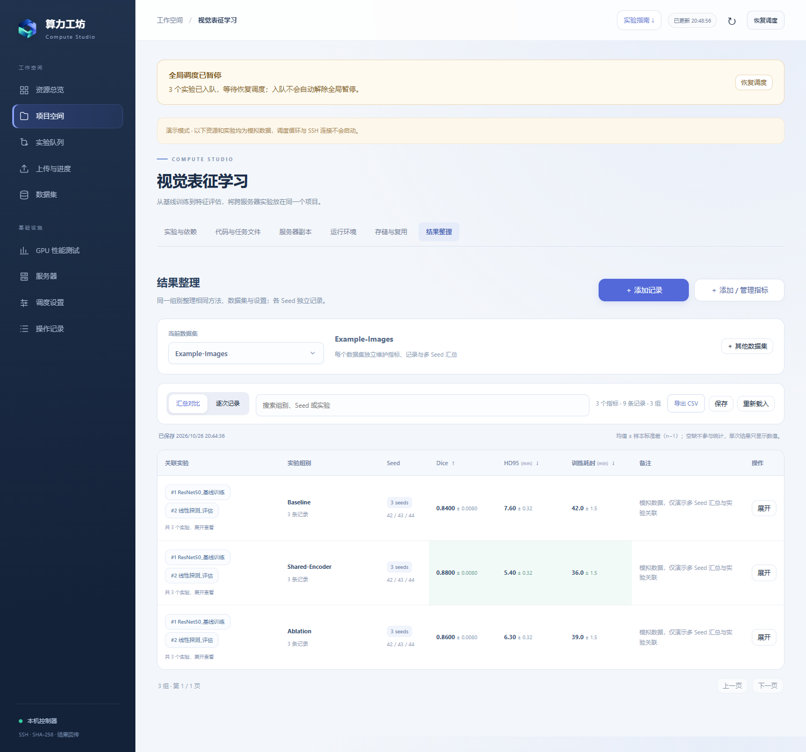

<p align="center">
  
</p>
<h1 align="center">算力工坊 · Compute Studio</h1>
<p align="center"><b>让代码跟随算力，让结果回到项目。</b></p>
<p align="center">一个以项目为中心的 SSH / GPU 实验调度工作台。只需浏览器，无需桌面客户端。</p>
<p align="center"><a href="#快速开始">快速开始</a> · <a href="#批量创建实验">批量导入</a> · <a href="docs/实验脚本与批量配置指导.md">完整使用指南</a> · <a href="#开发与测试">开发与测试</a></p>

---

你有几台 GPU 服务器、几组依赖实验，以及越来越多的代码、数据集和结果文件。Compute Studio 把这些工作放在同一个 Web 界面中：连接服务器、观察资源、选择合适的 GPU、执行实验，并把输出同步回本机。

控制器运行在你自己的电脑上，通过 SSH 管理 Linux GPU 服务器。服务器不需要另外启动常驻 Web 服务；实验环境和数据仍由你掌握。

> 本仓库提供程序源码、通用示例和测试。首次启动会创建新的工作空间，不附带任何真实项目、数据集、服务器配置、实验结果或登录凭据。

## 能做什么

| 工作 | 支持内容 |
| --- | --- |
| **管理算力** | 导入 SSH 配置，监测 GPU 显存、利用率、进程、CPU、内存与磁盘；按需运行 GPU 性能测试 |
| **自动调度** | 空闲卡、低干扰共享、紧急共享；结合优先级、显存需求、GPU 型号、服务器范围、资源新鲜度和基准结果选卡 |
| **组织实验** | 项目公共代码、任务专属文件、依赖 DAG、多 Seed、批量导入与批量修改配置 |
| **高效传文件** | SHA-256 内容库、缺失文件增量上传、按需引用前序输出；分别探测工作目录和数据目录的共享关系 |
| **维护代码** | 可绑定本机编辑目录自动同步；每次运行固定输入快照，运行中修改源码不覆盖已启动实验，回传不覆盖编辑中的代码 |
| **观察与控制** | 后台导入进度与中断、轮询最近 200 行日志、完整日志详情、暂停、恢复、整个实验进程树中断及安全重跑 |
| **整理研究记录** | 节点 Notes 支持 Markdown 和公式；按数据集维护独立指标与结果表，关联实验／运行，汇总多 Seed 均值 ± 样本标准差并导出 CSV |
| **保持工作区整洁** | 项目归档、实验单个／批量归档、状态筛选、受运行状态和依赖保护的远程副本清理 |

## 界面预览

下图全部使用程序生成的模拟数据，不包含真实服务器或实验。



<details>
<summary>查看实验流程与结果整理</summary>





</details>

## 快速开始

### 1. 准备环境

- **控制器电脑**：Python 3.9 或更新版本；建议使用独立虚拟环境。当前回归测试在 Windows 上验证。
- **目标服务器**：Linux、Python 3.9+、Bash、SSH/SFTP、NVIDIA 驱动和 `nvidia-smi`。
- **实验环境**：服务器自行准备所需 Conda / Python / CUDA 环境。GPU 性能测试另需可用的 PyTorch CUDA 环境。
- **浏览器**：支持现代 JavaScript 的浏览器。

正常使用不需要 Node.js、前端构建步骤或在控制器电脑上安装 CUDA。Markdown 与公式渲染资源已随仓库提供。

### 2. 下载并安装

```bash
git clone https://github.com/Yibinory/Compute-Studio.git
cd Compute-Studio
python -m venv .venv
```

Windows PowerShell：

```powershell
.\.venv\Scripts\python.exe -m pip install -r requirements.txt
.\.venv\Scripts\python.exe app.py
```

其他桌面系统可使用标准 Python 虚拟环境命令；系统密钥环、SSH 和文件权限需按本机环境配置：

```bash
./.venv/bin/python -m pip install -r requirements.txt
./.venv/bin/python app.py
```

Windows 也可以双击 `start_web.bat`，首次启动会创建虚拟环境并安装依赖。若首次安装失败，请先按上面的命令修复依赖再启动。

### 3. 登录自己的工作空间

打开 **http://127.0.0.1:8776/**。

首次运行会生成访问令牌，默认位于：

```text
data/access-token.txt
```

将其内容粘贴到登录页。这里的 `data/` 是新建的本地目录，**不是仓库下载内容**。如果配置了其他保存根目录，令牌和日志会跟随该目录，启动输出也会提示令牌位置。

项目和数据集可能占用大量空间。正式导入前，建议先在 **调度设置 → 本机保存地址** 选择容量充足的空目录。工具会复制并核验已有内容，再切换地址，原目录保留。

也可在每次启动时显式指定保存位置：

```powershell
.\.venv\Scripts\python.exe app.py --data-dir "D:\ComputeStudioData"
```

`--data-dir` 仅覆盖本次启动；希望以后双击启动仍沿用新地址，请通过网页设置保存。`COMPUTE_DATA_DIR` 环境变量也可覆盖默认保存目录。

### 4. 连接服务器，创建第一个项目

1. 在 **服务器** 页面导入本机 SSH 配置，或填写主机、端口、用户及认证方式。首次连接请核对主机指纹。
2. 为每台服务器配置**工作根目录**与**数据根目录**，例如 `/srv/compute-work`、`/mnt/datasets`。
3. 创建项目，上传公共代码，或配置本机代码目录自动同步。
4. 按服务器选择项目默认 Conda 环境，创建一个小实验草稿。
5. 检查命令、显存需求、服务器范围和数据集，然后入队。
6. 在流程图、实验详情和操作记录中观察运行、传输与回传状态。

环境优先级为：**实验的服务器专属环境 → 实验通用环境 → 项目的服务器默认环境 → 服务器默认环境 → 服务器原有执行环境**。

## 先体验演示模式

无需连接真实服务器即可查看界面：

```powershell
.\.venv\Scripts\python.exe app.py --demo --data-dir ./data-demo --port 8777
```

打开 http://127.0.0.1:8777/，令牌在 `data-demo/access-token.txt`。Windows 可双击 `start_demo.bat`。

演示模式生成模拟服务器、资源和实验，不启动自动调度循环。示例服务器不是可连接的主机；请不要对它们手动执行连接或基准测试。正式使用请回到普通工作空间添加真实服务器。

## 批量创建实验

在同一目录准备脚本、配置文件与任务专属输入，再在项目内点击 **批量导入实验**，提供控制器本机的目录地址。工具会后台读取配置，先预览，再一次创建草稿。导入时可以统一覆盖执行环境、调度级别和服务器范围。

仓库内提供一个可直接导入的通用示例：

```text
examples/batch-experiments/
├── experiments.json
├── train.sh
├── evaluate.sh
└── params.json
```

最小配置示例：

```json
{
  "version": 1,
  "defaults": {
    "level": "idle_only",
    "priority": 50,
    "memory_mb": 1024,
    "conda_env": "",
    "datasets": []
  },
  "experiments": [
    {
      "key": "train",
      "name": "训练",
      "script": "train.sh",
      "files": ["params.json"],
      "args": ["--seed", "42"]
    },
    {
      "key": "evaluate",
      "name": "评估",
      "script": "evaluate.sh",
      "depends_on": ["train"]
    }
  ]
}
```

脚本从工具准备的独立工作目录执行。建议使用 `set -euo pipefail`，让任何一步失败都体现在最终退出码中；正常完成返回 `0`。不要硬编码某台服务器的项目绝对路径。

```bash
#!/usr/bin/env bash
set -euo pipefail
mkdir -p outputs
python -u train.py --data "$DATASET_0" --output outputs "$@"
```

这个脚本假设实验声明了至少一个数据集。没有数据集的示例不要访问 `$DATASET_0`。跨节点通过 `DEPENDENCIES_JSON` 定位前序结果；后续只会在前序成功且完成本机回传后启动。

**请阅读 [完整使用与批量配置指南](docs/实验脚本与批量配置指导.md)**：包含全部字段、退出码和 OOM 约定、Shell 参数规则、环境覆盖、数据目录、权重引用、文件选择、依赖、运行控制和结果整理。编写批量实验时不需要查阅历史开发报告。

## 文件如何组织

本机保存根目录下，每个项目维护：

```text
projects/<project-id>/
├── code/                     # 当前公共代码
├── tasks/<task-id>/files/     # 任务专属输入
├── objects/<prefix>/<hash>   # 相同内容只保存一份
└── runs/<run-id>/            # 输入/输出清单、日志与控制记录
```

服务器工作根目录下是 `.compute-projects/<project-id>/`。点开头的目录可能在文件管理器中隐藏。运行工作区位于 `runs/<run-id>/workspace/`。

- **跨服务器依赖**：前序输出先回传本机并核验，目标服务器只补传缺失 hash。
- **数据集**：任务按名称解析为各服务器数据根目录下的同名文件夹；大数据可预先部署，也可通过工具异步上传。
- **共享目录**：工作根目录和数据根目录分别探测；相同路径字符串不代表共享。有效结果持久化复用，配置变化或手动重新探测时才更新。
- **权重**：已有实验权重使用依赖引用；外部共享权重先进入项目内容库，通过 `object_files` 引用，不必伪装成数据集。
- **代码安全**：运行使用固定输入快照，回传只保存本次输出，不覆盖本机编辑中的源码。
- **归档**：整理界面并退出调度，保留日志和文件；释放磁盘空间使用独立清理功能。

## 使用边界

- 适合个人或可信小团队的 GPU 实验编排；当前没有多用户角色权限和租户隔离。
- 访问令牌能控制 SSH 实验执行。默认只监听本机，远程使用优先通过 SSH 隧道；不要直接将原始服务暴露到公网。
- 低干扰共享基于资源观测与保守预留，不能隔离其他用户的 GPU 进程。
- 关闭控制器通常不会停止已启动的远程实验；再次打开会核实运行状态并继续处理回传。运行状态未知时会保留现场，不自动重跑或清理。
- 服务器重启导致的中断经核实后，会先保留日志、清理失败工作副本，再按原输入快照自动重新入队；默认最多 2 次、等待 30 秒，可在调度设置修改。尚未确认原进程停止的状态仍保留现场。
- 部分 OOM 判断使用退出码和日志启发式，仍需结合完整日志诊断。
- 更换电脑不会自动迁移原工作空间：需要自行备份保存根目录，并重新配置 SSH、主机信任和系统密钥环。

## 开发与测试

```powershell
.\.venv\Scripts\python.exe -m pip install -r requirements-dev.txt
.\.venv\Scripts\python.exe -m pytest tests -q
```

可选前端逻辑测试需要 Node.js，日常运行不需要：

```bash
node tests/test_graph_layout.js
node tests/test_benchmark_state.js
```

测试使用临时目录和模拟 SSH 服务器，不需要 GPU 或真实 SSH 凭据。Windows 上个别符号链接测试可能因系统权限跳过。请勿将测试产物或个人工作空间加入提交。

发布前可以使用允许列表导出与隐私检查：

```bash
python scripts/prepare_public_release.py
python scripts/audit_public_release.py release/compute-studio
```

导出目录已存在时工具会拒绝覆盖；请指定新的 `--output`。发布前仍应检查导出文件列表和文档中的个人信息。提交消息采用 **Conventional Commits**，例如 `fix(scheduler): avoid polling completed transfer history`。详见 [贡献说明](CONTRIBUTING.md)。

## 仓库结构

```text
app.py                Web API 与启动入口
scheduler/            SSH、资源探测、调度、传输、内容库与持久化
templates/            页面模板
static/               网页脚本、样式、Logo 与第三方渲染资源
examples/             通用训练/评估与批量导入示例
docs/                 完整指南与模拟界面截图
tests/                隔离回归测试
scripts/              干净源码导出与发布检查
```

## 许可证与第三方组件

本项目暂未添加项目级许可证。第三方组件保留各自的许可证，见 [第三方组件说明](THIRD_PARTY_NOTICES.md) 及 `static/vendor/` 中的原文。

欢迎通过 [GitHub Issues](https://github.com/Yibinory/Compute-Studio/issues) 反馈问题。请附复现步骤、系统与 Python 版本、经过脱敏的错误信息；不要上传令牌、私钥、真实数据集或实验结果。
